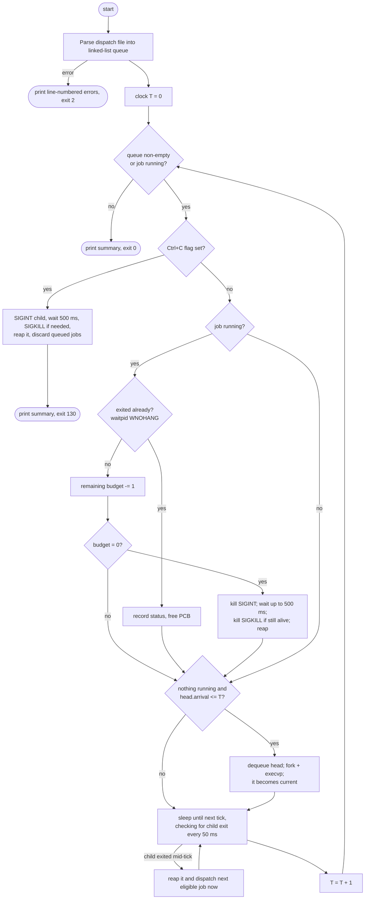

# Batch Process Monitor: FCFS and Round-Robin Process Dispatchers in C

A Linux **batch process monitor** that reads a list of jobs from a *dispatch file* and runs them as real child processes using one of two schedulers. **First-Come, First-Served (FCFS)** runs each job to completion. **Round-Robin (RR)** (`--rr`) gives each job a time slice, suspending it with `SIGTSTP` and resuming it later with `SIGCONT`. Both are built on `fork()`, `execvp()`, `waitpid()` and `kill()`, and both enforce a per-job CPU-time budget with `SIGINT`, falling back to `SIGKILL` if a job ignores the interrupt.

*Operating Systems end-semester project, ID 25.*

---

## Team

| Roll number | Name | Role |
|---|---|---|
| AP24110010677 | **Lakshay** | **Team Leader** |
| AP24110011219 | Md Ahab Firoz | Member |
| AP24110010386 | Akshita Modi | Member |
| AP24110011380 | N. Shanmuka Abhiram | Member |

### Who did what

| Member | Contribution | Main code / files |
|---|---|---|
| **Lakshay** (Team Leader) | Planned the project and the overall architecture, split the work, and built the dispatcher core: the FCFS main loop, launching jobs with `fork()` + `execvp()`, the budget countdown with SIGINT → SIGKILL termination, the Round-Robin dispatcher (input and RR queues, SIGTSTP/SIGCONT suspend and resume, SIGSTOP fallback), and safe Ctrl+C handling. Integrated everyone's parts, reviewed the code and set up the GitHub repository. | `run_dispatcher()`, `dispatch_next()`, `dispatch_next_rr()`, `suspend_current()`, `resume_job()`, `unload_arrivals()`, `wait_for_tick()`, `launch_job()`, `terminate_current()`, `shut_down()`, signal handlers |
| **Md Ahab Firoz** | Built the dispatch-file parser: support for both input formats (including the sheet's commandless process list, which runs the default `sleepy`), splitting commands into arguments (including quotes), validating every field, and line-numbered error messages, plus the check that arrival times never decrease. | `load_dispatch_file()`, `parse_line()`, `tokenize_command()`, `parse_int()`, `trim()` |
| **Akshita Modi** | Designed the Process Control Block and the linked-list ready queue, and wrote the process-reaping and status code (`waitpid()`, exit status vs. signal) along with the final summary table, the waiting/turnaround-time metrics (FCFS and RR) and the Gantt chart. | `struct pcb`, `enqueue()`, `dequeue()`, `poll_current()`, `finish_current()`, `retire_job()`, `print_summary()`, `print_gantt()`, `record_tick()` |
| **N. Shanmuka Abhiram** | Owned testing and the build: wrote the `sleepy` program from the sheet, the `test_worker` helper program, all the test dispatch files (including the RR/Stallings list) and the automated test suite, wrote the Makefile, and ran the valgrind memory checks. | `src/sleepy.c`, `tests/test_worker.c`, `tests/run_tests.sh`, `tests/jobs_*.txt`, `Makefile` |
| **Everyone** | Wrote the documentation (this README and the viva guide) and tested on Linux before submission. | `README.md`, `docs/VIVA_GUIDE.md` |

---

## 0. Project-sheet compliance

Every requirement on the project sheet, and where it is implemented:

| Project-sheet requirement | Status | Where / how |
|---|---|---|
| Accept a list of programs from a file and run them FCFS | Done | `load_dispatch_file()` + `dispatch_next()` |
| Arrival time per program: a job cannot start before its arrival time | Done | `dispatch_next()` only starts the head when `arrivaltime <= clock` |
| Command list format `0,sleepy 3` … | Done | `tests/jobs_sheet_sleepy.txt`, the sheet's list exactly as given |
| The `sleepy` program used in the examples | Done | `src/sleepy.c` → `build/sleepy` (`sleepy N` sleeps N s; `sleepy` with no argument runs until stopped) |
| Process-list format `<arrival>,<priority>,<cputime>,<memory>,<res1>…<res4>`, e.g. `0, 0, 3, 64, 0, 0, 0, 0` (spaces after commas) | Done | `tests/jobs_sheet_processlist.txt`, exactly as given. Lines with no command run the default program `sleepy` until their CPU time runs out (`make run`) |
| Queue of job structures; dequeue only when the time has come and nothing is running | Done | `Queue` (linked list), `dequeue()`, `Dispatcher.current` |
| Jobs are in chronological order of arrival (guaranteed) | Done, and checked | out-of-order files are rejected with the line number |
| `struct pcb` with `pid`, `args[MAXARGS]`, `arrivaltime`, `remainingcputime`, `next`; `typedef Pcb`, `PcbPtr` | Done | `struct pcb` (same fields and names, plus lifecycle fields) |
| Algorithm: initialise queue → fill from file → start timer | Done | `main()` → `load_dispatch_file()` → `run_dispatcher()` |
| While queue non-empty or a process is running | Done | `while (d->queue.head \|\| d->current)` |
| If running: decrement `remainingcputime`; if time's up, send **SIGINT** and free the structure | Done | `run_dispatcher()` → `terminate_current(d, SIGINT)` → `retire_job()` frees the PCB |
| If nothing running, queue not empty, head arrived: dequeue, **fork & exec**, set as current | Done | `dispatch_next()` → `launch_job()` (`fork()` + `execvp()`) |
| Sleep one second, increment timer, repeat; the tests come *before* the sleep (sheet's order) | Done | `wait_for_tick()`, then `d->clock++`. Same order as the sheet |
| Exit when everything has finished | Done | the loop ends, the summary is printed, exit 0 |
| Priority used for scheduling | Not used, on purpose | The sheet says priority matters in *later* dispatchers. FCFS ignores it; it is stored and shown as metadata |
| **Round-Robin dispatcher** | Done | `--rr` (§7b) |
| RR: input queue + RR queue | Done | `Dispatcher.queue` (input) and `Dispatcher.rrqueue` |
| RR: unload pending processes, input → RR queue, while head.arrival ≤ timer | Done | `unload_arrivals()`, the first step of every tick, as on the sheet |
| RR: decrement `remainingcputime`; if time's up, SIGINT and free | Done | same code path as FCFS |
| RR: else if others are waiting, **SIGTSTP** to suspend and enqueue it back | Done | `suspend_current()` (confirms the stop with `waitpid(WUNTRACED)`; SIGSTOP if SIGTSTP is ignored) |
| RR: if nothing running, dequeue; **SIGCONT** if suspended, else fork & exec | Done | `dispatch_next_rr()` → `resume_job()` or `launch_job()` |
| RR: sheet's job list with q = 1 must reproduce **Stallings Fig. 9.5** | Done, and checked | `tests/jobs_rr_stallings.txt`. The dispatch order, finish times and Gantt chart match the figure tick for tick, and `make test` checks them |

Running the sheet's process list produces the textbook FCFS schedule: jobs finish at 3, 9, 13, 18 and 20, average waiting time 4.60, average turnaround 8.60. Running the RR job list with `--rr` produces Stallings Figure 9.5 exactly: finish times A=4, B=18, C=17, D=20, E=15, mean turnaround 10.80. Both are checked automatically by `make test`.

## 1. Academic objective

The project shows how an operating system's **dispatcher** manages processes:

- holding jobs in a ready queue,
- deciding which one runs next,
- creating each job as a real process,
- watching it run,
- stopping it when its time is up, and
- cleaning up after it, with no zombies or orphans.

This version implements both dispatchers from the project sheet, exactly as specified (see §0, *Project-sheet compliance*): **FCFS** (the default) and **Round-Robin** (`--rr`, quantum 1 by default). The Round-Robin dispatcher is the first step towards the multilevel feedback dispatcher of Project 2, which is essentially several RR queues.

## 2. Features

- **Real processes.** Every job runs through `fork()` + `execvp()`. Nothing is simulated.
- **Linked-list ready queue** of Process Control Blocks (PCBs), with separate head and tail pointers. The running process is tracked separately as `current`.
- **Strict FCFS order.** Jobs run in arrival order. Jobs that arrive together run in file order, and a later job can never overtake an earlier one.
- **Round-Robin with a time quantum** (`--rr [--quantum N]`). A job that has used its slice while others wait is suspended with `SIGTSTP` (or `SIGSTOP` if it ignores that), moved to the back of the RR queue, and resumed later with `SIGCONT`. On the sheet's job list it reproduces Stallings Figure 9.5 exactly.
- **Gantt chart** printed at the end of every run, in the same layout as Stallings' figures.
- **Arrival times are respected.** No job starts before it arrives. While nothing has arrived yet, the CPU is idle and the output says so.
- **CPU-time budget.** The budget is decremented once per one-second dispatcher tick. When it reaches zero, the dispatcher sends `SIGINT`. If the child is still alive 500 ms later, it sends `SIGKILL`.
- **Every child is reaped** with `waitpid()`. The output distinguishes four outcomes:
  - normal exit,
  - nonzero exit status,
  - death by a signal (a crash),
  - a program that could not be executed.
- **Exec-failure detection** uses a close-on-exec pipe. The dispatcher can tell "program not found" apart from "program ran and returned 127".
- **Safe Ctrl+C.** The signal handler only sets a flag. The main loop then stops the running child, reaps it, lists the jobs that never started, prints the summary and exits with status 130.
- **Robust parser:**
  - two formats (simple and full 8-field metadata),
  - comment and blank lines,
  - whitespace trimming,
  - Windows (CRLF) line endings,
  - quoted arguments,
  - any line length,
  - line-numbered error messages, with every error reported in one pass,
  - a check that arrival times never decrease.
- **Clear terminal output.** Every event carries the dispatcher clock (`[T=n]`). The final summary table shows start, finish, waiting time, turnaround time, the real elapsed seconds and each job's result.
- **Automated test suite** (`make test`): 35 tests with real child processes, including the project sheet's three example lists exactly as written (two FCFS, one Round-Robin). Each one checks exit codes and output, and confirms that no worker process is left running.

## 3. Operating Systems concepts demonstrated

| Concept | Where it appears |
|---|---|
| Process creation | `fork()` in `launch_job()` |
| Program loading | `execvp()` in the child branch of `launch_job()` |
| Process Control Block | `struct pcb` |
| Ready queue / FIFO | `Queue`, `enqueue()`, `dequeue()` |
| FCFS scheduling | `dispatch_next()`: only the queue head is ever started |
| Process termination, exit status | `waitpid()`, `WIFEXITED`, `WEXITSTATUS`, `WIFSIGNALED`, `WTERMSIG` in `finish_current()` |
| Zombie prevention | `poll_current()` (non-blocking `waitpid` every 50 ms) and blocking reaps after exec failure or `SIGKILL` |
| Signals | `kill(pid, SIGINT)`, `kill(pid, SIGKILL)`; `sigaction()` handler for Ctrl+C |
| Preemption, suspend/resume | `kill(pid, SIGTSTP)` / `SIGSTOP` in `suspend_current()`, `kill(pid, SIGCONT)` in `resume_job()`, `waitpid(…, WUNTRACED)` to confirm the stop |
| Round-Robin scheduling | input queue → RR queue, time quantum, re-queue at the tail (`run_dispatcher()`, `dispatch_next_rr()`) |
| Async-signal safety | the handler only writes a `volatile sig_atomic_t` flag |
| `EINTR` handling | `waitpid()`, `read()`, `nanosleep()` loops |
| Process groups | `setpgid()`: each job gets its own group, so Ctrl+C reaches only the dispatcher |
| Monotonic time | `clock_gettime(CLOCK_MONOTONIC)` with absolute tick deadlines (no drift) |
| Scheduling metrics | waiting time and turnaround time per job, plus averages |

## 4. Architecture

The dispatcher is **one self-contained C file**, `src/batch_monitor.c` (about 1,300 lines, heavily commented), so it can be submitted and compiled on its own. The specification suggested an optional `include/batch_monitor.h`. It is deliberately left out: a header used by a single `.c` file adds a second file to submit and explains nothing new.

```
batch-process-monitor/
├── src/
│   ├── batch_monitor.c        # the dispatcher (the file to submit)
│   └── sleepy.c               # the sheet's example program (sleepy N / sleepy)
├── tests/
│   ├── test_worker.c          # safe helper job: sleeps/spins, prints, exits as told
│   ├── run_tests.sh           # automated test suite (make test)
│   ├── jobs_sheet_processlist.txt # the sheet's process list, exactly as given (make run)
│   ├── jobs_sheet_sleepy.txt  # the sheet's "0,sleepy 3" list, exactly as given
│   ├── jobs_rr_stallings.txt  # the sheet's Round-Robin list (make run-rr)
│   ├── jobs_basic.txt         # spec example, 8 fields + sleep commands
│   ├── jobs_simple_format.txt # spec example, simple format
│   ├── jobs_single.txt        # one job at T=0
│   ├── jobs_equal_arrival.txt # several jobs at T=0 (file order kept)
│   ├── jobs_arrival_times.txt # different arrivals + idle CPU
│   ├── jobs_early_exit.txt    # natural exit before budget expires
│   ├── jobs_budget_expiry.txt # SIGINT at budget; SIGKILL fallback
│   ├── jobs_error_cases.txt   # missing program, exit 3, crash (SIGABRT)
│   ├── jobs_interrupt.txt     # long jobs for the Ctrl+C test
│   ├── jobs_cpu_vs_wall.txt   # viva demo: budget is elapsed time, not CPU use
│   ├── jobs_malformed.txt     # parser errors with line numbers
│   ├── jobs_empty.txt         # no jobs
│   └── jobs_decreasing.txt    # arrival times out of order
├── docs/
│   └── VIVA_GUIDE.md          # viva questions & answers, function guide, demo script
├── Makefile
├── README.md
├── .gitignore
└── LICENSE
```

The source file is organised in layers, from top to bottom:

1. **Constants and data structures:** `struct pcb`, `Queue`, `JobRecord`, `Dispatcher`.
2. **Helpers:** time, logging, signal names.
3. **PCB and queue:** `pcb_new`, `pcb_free`, `enqueue`, `dequeue`.
4. **Parser:** `load_dispatch_file` → `parse_line` → `tokenize_command`.
5. **Child lifecycle:** `launch_job`, `poll_current`, `finish_current`, `terminate_current`.
6. **Dispatcher loop:** `run_dispatcher`, `dispatch_next`, `wait_for_tick`, `shut_down`.
7. **Output and `main()`:** banner, job table, summary, signal handlers.



## 5. The Process Control Block (PCB)

The PCB starts from the structure given in the specification, then adds the fields needed to manage a process's whole lifecycle:

```c
struct pcb {
    /* --- fields from the assignment's PCB --- */
    pid_t pid;                 /* child PID once launched, 0 before            */
    char *args[MAXARGS];       /* argv for execvp(), NULL-terminated, malloc'd */
    int arrivaltime;           /* dispatcher tick at which the job arrives     */
    int remainingcputime;      /* ticks of budget left, or NO_BUDGET           */
    struct pcb *next;          /* next PCB in the linked-list queue            */

    /* --- extensions for lifecycle management --- */
    int argc;  char *cmdline;  int jobid;  int lineno;
    int cputime;               /* original budget                            */
    bool has_metadata;  int priority;  int memory;  int resources[4];
    ProcState state;           /* READY -> RUNNING -> TERMINATED             */
    long starttick, finishtick;          /* dispatcher clock values          */
    struct timespec start_mono, end_mono;/* real monotonic timestamps        */
    int waitstatus;            /* raw status from waitpid()                  */
    bool budget_expired, used_sigkill, interrupted;  /* termination reason   */
};
typedef struct pcb Pcb;
typedef Pcb *PcbPtr;
```

Ownership rules:

- Each `args[i]` string and `cmdline` are allocated with `malloc` or `strdup`, and `pcb_free()` releases them.
- When a job finishes, `retire_job()` copies what the summary needs into a small `JobRecord` and then frees the PCB right away. This is step (c) of the specification: *"reap the terminated child and free its process structure"*.
- Priority, memory and the four resource fields are **kept only as metadata**. The job table shows them, but FCFS does not use them.

## 6. The linked-list queue

```c
typedef struct { PcbPtr head; PcbPtr tail; int count; } Queue;
```

- `enqueue()` appends at the **tail** in O(1). Jobs are loaded in file order, so equal arrival times keep their file order.
- `dequeue()` removes from the **head** in O(1). The job that came first is served first.
- The job that is running is **not** in the queue. It is held separately in `Dispatcher.current`, and there is never more than one.

## 7. FCFS scheduling

FCFS is **non-preemptive**: once a job gets the CPU, it keeps it until it finishes. A job can lose the CPU early in only two cases:

- its CPU-time budget runs out, or
- the user presses Ctrl+C.

The dispatcher only ever looks at the **head** of the queue, and only when nothing is running. The head is started once its arrival time ≤ the dispatcher clock.

For the specification's example, the schedule produced is the textbook FCFS Gantt chart. This was **verified by running it**; the test suite checks it on every run.

| Job | Command | Arrival | Start | Finish | Waiting | Turnaround |
|---|---|---|---|---|---|---|
| 1 | `sleep 3` | 0 | 0 | 3 | 0 | 3 |
| 2 | `sleep 6` | 2 | 3 | 9 | 1 | 7 |
| 3 | `sleep 4` | 4 | 9 | 13 | 5 | 9 |
| 4 | `sleep 5` | 6 | 13 | 18 | 7 | 12 |
| 5 | `sleep 2` | 8 | 18 | 20 | 10 | 12 |

Average waiting time is 4.60 ticks and average turnaround is 8.60 ticks.

## 7b. Round-Robin scheduling (`--rr`)

```bash
./build/batch_monitor --rr tests/jobs_rr_stallings.txt          # quantum 1 (as on the sheet)
./build/batch_monitor --rr --quantum 2 tests/jobs_rr_stallings.txt
make run-rr
```

Round-Robin is **preemptive**. Each job gets the CPU for at most one *quantum* (default 1 tick). If other jobs are waiting when the quantum is used up, the running job is paused and goes to the back of the queue. If nobody is waiting, it simply keeps the CPU.

There are two queues: the **input queue** (jobs that have not arrived yet) and the **RR queue** (jobs that have arrived and are waiting for the CPU, both new and suspended). Every tick runs the sheet's algorithm in the sheet's order:

1. **Unload arrivals:** while the head of the input queue has `arrivaltime <= timer`, move it to the back of the RR queue.
2. **If a job is running:** decrement `remainingcputime`.
   - If it reaches 0, send `SIGINT` and free the PCB, as in FCFS.
   - Otherwise, if its quantum is used up and the RR queue is not empty, send **`SIGTSTP`** to suspend it and enqueue it at the back of the RR queue.
3. **If no job is running:** dequeue the head of the RR queue.
   - If it was started before (it has a PID and is suspended), send **`SIGCONT`** to restart it.
   - Otherwise start it with `fork()` + `execvp()`.
4. **Sleep one tick** and increment the timer.

**Why step 1 comes first.** A job that arrives in the same tick as a preemption is queued *ahead* of the preempted job. That is exactly how Stallings Figure 9.5 orders them. For example, at T=4 job C arrives just as B is waiting, and C runs before B gets its next turn.

**Making the suspend reliable:**

- `SIGTSTP` is a polite stop request (the signal Ctrl+Z sends), so a program can catch or ignore it. After sending it, `suspend_current()` checks with `waitpid(pid, …, WNOHANG | WUNTRACED)` that the child really is stopped.
- If the child has not stopped within 500 ms, the dispatcher sends `SIGSTOP`, which cannot be caught or ignored. `tests/test_worker --ignore-sigtstp` tests this path.
- While a job is suspended, its process is in state **T** (stopped) in `ps`, and the test suite checks this.
- On Ctrl+C, every suspended job is also sent `SIGINT` + `SIGCONT` (a stopped process cannot act on SIGINT until it runs), then reaped. No stopped processes are left behind.

**Real output** for the sheet's job list, `./build/batch_monitor --rr tests/jobs_rr_stallings.txt`, where the jobs are labelled A–E as in Stallings:

```
JOB  PID      COMMAND                       ARRIVE  BUDGET  START  FINISH  WAIT  TURN  ELAPSED  RESULT
---  -------  ----------------------------  ------  ------  -----  ------  ----  ----  -------  ------------------------
  1  243      sleepy                             0       3      0       4     1     4     4.05  budget expired: SIGINT
  2  244      sleepy                             2       6      2      18    10    16    16.04  budget expired: SIGINT
  3  245      sleepy                             4       4      5      17     9    13    12.04  budget expired: SIGINT
  4  246      sleepy                             6       5      7      20     9    14    13.04  budget expired: SIGINT
  5  248      sleepy                             8       2     10      15     5     7     5.04  budget expired: SIGINT

Jobs started: 5 of 5.  Average waiting time: 6.80 ticks.  Average turnaround: 10.80 ticks.
Dispatcher ran for 20 tick(s) (20.05 s real time), CPU idle for 0 tick(s).

Gantt chart (one column = one tick, # = job holds the CPU):
            0    5    10   15   20 
            |....|....|....|....|
A (Job 1)   ## #                
B (Job 2)     # # #  #   #   #  
C (Job 3)        #  #   #   #   
D (Job 4)          #   #   #  ##
E (Job 5)             #   #     
```

This is **identical to Stallings Figure 9.5 (RR, q = 1)**. The turnaround times are A=4, B=16, C=13, D=14, E=7 (mean 10.80), which match Stallings' table. The same five jobs under FCFS have mean turnaround 8.60. RR gives short jobs a quicker first response, at the cost of a longer average turnaround here.

In RR mode, **WAIT = turnaround − ticks on the CPU**: the total time a job spent ready in the RR queue, across all its turns. In FCFS this equals start − arrival.

## 8. Dispatch-file format

Each line is one job. Blank lines are ignored, and so are lines whose first non-space character is `#`. Two formats are accepted, and they can be mixed in one file.

**Format 1: simple**

```
<arrival time>,<command and arguments>
```
```
0,sleep 3
2,sleep 6
```

A simple-format job has **no CPU-time budget**: it runs until it exits by itself (pure FCFS).

**Format 2: full metadata.** These are the project sheet's 8 fields, optionally followed by a command:

```
<arrival>,<priority>,<CPU time>,<memory>,<res1>,<res2>,<res3>,<res4>[,<command and arguments>]
```
```
0, 0, 3, 64, 0, 0, 0, 0
0,0,3,64,0,0,0,0,sleep 3
2,0,6,64,0,0,0,0,test_worker 4 --name "job two"
```

The first line is the sheet's format exactly. It has **no command**, so the dispatcher runs the default program `sleepy`. `sleepy` keeps running until the job's CPU time runs out and the dispatcher stops it with SIGINT, so each job lasts exactly its `cputime`.

**Bundled programs without a path.** On start-up, the dispatcher puts its own directory (`build/`) first in `PATH`, and children inherit it. A command can therefore say `sleepy 3` or `test_worker 2`, exactly as on the sheet, instead of `./build/sleepy 3`.

### How a line is parsed

1. **Choosing the format.** If the field after the first comma is an integer, the line is in the full format and must contain all 8 numeric fields, optionally followed by a command (default: `sleepy`). Otherwise it is in the simple format.
2. **The command.** Everything after the 8th comma (full format) or after the 1st comma (simple format) is the command. The command may therefore contain commas: `0,echo a,b` prints `a,b`.
3. **Splitting into arguments.** The command is split into arguments at spaces and tabs. Single or double quotes group words, so `--name "two words"` is one argument (the quotes are removed). There are no shell features: pipes, `>`, `$VAR` and `*` are passed through literally. If you need them, run a shell explicitly: `0,sh -c 'ls | wc -l'`.
4. **Whitespace.** Spaces around every field and around the command are trimmed. Windows `\r\n` line endings are accepted.

### Validation

Every line is checked. All errors are reported together, as `file:line: error: …`, and **no job is started** if any line is invalid.

| Rule | Error example |
|---|---|
| Numbers must be integers | `arrival time 'abc' is not a valid integer` |
| No negative fields | `arrival time must not be negative (got -1)` |
| CPU time ≥ 1 | `CPU time must be at least 1 tick (got 0)` |
| All 8 numeric fields | `metadata format needs 8 numeric fields (optionally followed by a command), but only 7 field(s) were found` |
| Comma separator | `missing ',': expected '<arrival>,<command>' or …` |
| Balanced quotes | `unterminated ' quote in command` |
| At most 63 arguments | `command has more than 63 arguments` |
| Non-decreasing arrivals | `arrival time 3 is earlier than 5 on line 3; …` |
| At least one job | `'file' contains no jobs (only blank lines or comments).` |

Lines are read with `getline()`, which grows its buffer as needed, so there is **no fixed line-length limit** and no buffer overflow. The tests run a 20,000-character line.

### Exit codes of `batch_monitor`

| Code | Meaning |
|---|---|
| 0 | dispatcher ran every job (individual job failures are shown in the summary) |
| 1 | bad command-line usage |
| 2 | dispatch file missing, unreadable, empty or malformed |
| 3 | out of memory / fatal system error |
| 130 / 143 / 129 | stopped by SIGINT (Ctrl+C) / SIGTERM / SIGHUP (128 + signal number) |

## 9. Compilation

The project needs **Linux** with `gcc` and `make` (on Ubuntu or Debian: `sudo apt install build-essential`). No other libraries are needed, and nothing needs root.

```bash
make                 # builds build/batch_monitor, build/sleepy and build/test_worker
```

The exact commands `make` runs:

```bash
mkdir -p build
gcc -std=c11 -Wall -Wextra -Wpedantic -O2 -g -o build/batch_monitor src/batch_monitor.c
gcc -std=c11 -Wall -Wextra -Wpedantic -O2 -g -o build/sleepy src/sleepy.c
gcc -std=c11 -Wall -Wextra -Wpedantic -O2 -g -o build/test_worker tests/test_worker.c
```

Both files compile with **zero warnings**. The POSIX feature-test macro `_POSIX_C_SOURCE 200809L` is defined at the top of each `.c` file, so the submitted file also compiles on its own:

```bash
gcc -std=c11 -Wall -Wextra -Wpedantic -o batch_monitor batch_monitor.c
```

### Not on Linux?

macOS is *not* Linux. It lacks `prctl()`, which the code skips with `#ifdef __linux__`, and its process and signal details differ. Use one of these instead:

- **Windows:** WSL 2. Run `wsl --install` in an admin PowerShell, reboot, open "Ubuntu", then `sudo apt install build-essential git`.
- **macOS or Windows:** a free VM such as VirtualBox or UTM running Ubuntu 22.04/24.04, or a university Linux lab machine.
- **Any browser:** GitHub Codespaces on your repository (it runs Ubuntu).

## 10. Usage

```bash
./build/batch_monitor tests/jobs_sheet_processlist.txt   # the sheet's process list
./build/batch_monitor tests/jobs_sheet_sleepy.txt        # the sheet's "0,sleepy 3" list
./build/batch_monitor --help                             # usage
./build/batch_monitor --version                          # version
make run                                                 # same as the first line
./build/batch_monitor --rr tests/jobs_rr_stallings.txt   # Round-Robin, quantum 1
./build/batch_monitor --rr --quantum 2 FILE              # Round-Robin, quantum 2
make run-rr                                              # the RR list with --rr
```

Run commands from the **repository root**: some sample files refer to `./build/test_worker`.

**The test worker.** `build/test_worker` is a safe helper job. It only sleeps (or spins) and prints.

```
test_worker <seconds> [--exit CODE] [--ignore-sigint] [--ignore-sigtstp] [--abort] [--busy] [--name LABEL]
```

| Option | Effect |
|---|---|
| `<seconds>` | how long it runs, printing progress once a second |
| `--exit CODE` | exits with this status when finished |
| `--ignore-sigint` | ignores SIGINT, which forces the dispatcher's SIGKILL fallback |
| `--ignore-sigtstp` | ignores SIGTSTP, which forces Round-Robin's SIGSTOP fallback |
| `--abort` | crashes with SIGABRT (core dumps are disabled first) |
| `--busy` | burns real CPU instead of sleeping, and reports its actual CPU time |
| `--name LABEL` | label printed on every line |

## 11. Tests

```bash
make test            # all 35 tests, about 2.5 minutes (real 1-second ticks)
QUICK=1 make test    # skips the five 20-second example lists, about 45 s
make memcheck        # optional: valgrind leak check
```

Each test's full output is saved in `build/test_logs/`. The 15 required scenarios map to tests and files as follows:

| # | Scenario | How it is run | Expected behaviour |
|---|---|---|---|
| 1 | One job at T=0 | `./build/batch_monitor tests/jobs_single.txt` | starts at T=0, exits by itself at T=2, "completed (exit 0)" |
| 2 | Several jobs at T=0 | `tests/jobs_equal_arrival.txt` | A, B, C run one after another |
| 3 | Different arrival times | `tests/jobs_arrival_times.txt` | B arrives while A runs and waits; starts at 4 and 5 |
| 4 | Idle CPU before arrival | `tests/jobs_arrival_times.txt` | "CPU idle. Next job (Job 1) arrives at T=2." |
| 5 | Natural exit before budget | `tests/jobs_early_exit.txt` | "completed (exit 0)", no budget expiry |
| 6 | Budget expires | `tests/jobs_budget_expiry.txt` | job 1: SIGINT at T=3, "budget expired: SIGINT" |
| 7 | Nonexistent executable | `tests/jobs_error_cases.txt` | "could not execute …: No such file or directory"; next jobs still run |
| 8 | Malformed record | `tests/jobs_malformed.txt` | 8 line-numbered errors, no job started, exit 2 |
| 9 | Empty file | `tests/jobs_empty.txt` and a 0-byte file | "contains no jobs", exit 2 |
| 10 | Nonexistent input file | `./build/batch_monitor nope.txt` | "cannot open dispatch file …", exit 2 |
| 11 | Child exits nonzero | `tests/jobs_error_cases.txt` | "failed (exit 3)" |
| 12 | Ctrl+C during execution | `tests/jobs_interrupt.txt`, press Ctrl+C | child stopped and reaped, job 2 "not started", exit 130 |
| 13 | Child ignores SIGINT | `tests/jobs_budget_expiry.txt` (job 2) | "sending SIGKILL (last resort)", "budget expired: SIGKILL" |
| 14 | Decreasing arrival times | `tests/jobs_decreasing.txt` | "arrival time 3 is earlier than 5 on line 3", exit 2 |
| 15 | Equal arrivals keep file order | `tests/jobs_equal_arrival.txt` | the order A, B, C is checked |
| RR-1 | Sheet's RR list = Stallings Fig 9.5 | `--rr tests/jobs_rr_stallings.txt` | the exact dispatch order (18 dispatches), finish times, averages and Gantt rows are checked |
| RR-2 | Two jobs alternate, q = 1 | generated file | the order 1,2,1,2,1,2 is checked; a suspended child is in state T in `ps` |
| RR-3 | `--quantum 2` | generated file | each job gets 2 ticks per turn |
| RR-4 | Job ignores SIGTSTP | `test_worker --ignore-sigtstp` | "sending SIGSTOP (cannot be ignored)" |
| RR-5 | Ctrl+C with suspended jobs | generated file | every suspended child is stopped and reaped, exit 130 |

There are also extra tests for:

- the command-line interface,
- crashes (SIGABRT),
- Ctrl+C while the child ignores SIGINT,
- SIGTERM,
- a directory passed as the input file,
- CRLF line endings,
- commas inside a command,
- argument limits,
- very long lines,
- a no-zombie check while jobs run,
- an orphan check after every test.

In the automated suite, the Ctrl+C tests send `SIGINT` to the dispatcher with `kill -INT`. A real Ctrl+C typed in a terminal was also tested separately, through a pseudo-terminal, and gave the same result. To try it yourself, run `./build/batch_monitor tests/jobs_interrupt.txt` and press Ctrl+C after a few seconds.

## 12. Sample output

The output below is real, from running `./build/batch_monitor tests/jobs_budget_expiry.txt`. PIDs will differ on your machine.

```
[T=0] Dispatcher clock initialized to 0.
[T=0] Job 1 arrived (./build/test_worker 30 --name stubborn-no). Jobs ahead of it: 0.
[T=0] Job 2 arrived (./build/test_worker 30 --ignore-sigint --name stubborn-yes). Jobs ahead of it: 1.
[T=0] Job 1 is eligible (arrived at T=0) and is first in the queue.
[T=0] Starting Job 1: ./build/test_worker 30 --name stubborn-no
[T=0] Child launched with PID 1337. CPU-time budget: 3 tick(s).
    [stubborn-no pid=1337] started: will run 30 s (sleeping), then exit
[T=1] PID 1337 running. Remaining budget: 2
    [stubborn-no pid=1337] progress 1/30 s
[T=2] PID 1337 running. Remaining budget: 1
    [stubborn-no pid=1337] progress 2/30 s
[T=3] CPU-time budget expired for PID 1337.
[T=3] Sending SIGINT to PID 1337.
[T=3] Child reaped: PID 1337 was terminated by signal 2 (SIGINT) after 3.05 s.
[T=3] Job 2 is eligible (arrived at T=0) and is first in the queue.
[T=3] Starting Job 2: ./build/test_worker 30 --ignore-sigint --name stubborn-yes
[T=3] Child launched with PID 1338. CPU-time budget: 2 tick(s).
    [stubborn-yes pid=1338] started: will run 30 s (sleeping), then exit (ignoring SIGINT)
[T=4] PID 1338 running. Remaining budget: 1
    [stubborn-yes pid=1338] progress 1/30 s
[T=5] CPU-time budget expired for PID 1338.
[T=5] Sending SIGINT to PID 1338.
    [stubborn-yes pid=1338] progress 2/30 s
[T=5] PID 1338 did not exit within 500 ms of SIGINT; sending SIGKILL (last resort).
[T=5] Child reaped: PID 1338 was terminated by signal 9 (SIGKILL) after 2.45 s.
[T=5] All jobs finished. Dispatcher exiting.

Final execution summary (START/FINISH/WAIT/TURN in dispatcher ticks, ELAPSED in real seconds):
JOB  PID      COMMAND                       ARRIVE  BUDGET  START  FINISH  WAIT  TURN  ELAPSED  RESULT
---  -------  ----------------------------  ------  ------  -----  ------  ----  ----  -------  ------------------------
  1  1337     test_worker 30 --name stu...       0       3      0       3     0     3     3.05  budget expired: SIGINT
  2  1338     test_worker 30 --ignore-s...       0       2      3       5     3     5     2.45  budget expired: SIGKILL

Jobs started: 2 of 2.  Average waiting time: 1.50 ticks.  Average turnaround: 4.00 ticks.
Dispatcher ran for 5 tick(s) (5.50 s real time), CPU idle for 0 tick(s).
```

Lines indented with four spaces are printed by the **child** (`test_worker`). Lines starting with `[T=n]` are printed by the **dispatcher**.

## 13. The system calls, briefly

| Call | What it does here |
|---|---|
| `fork()` | Creates a copy of the dispatcher. It returns `0` in the child and the child's PID in the parent. |
| `execvp(file, argv)` | Used by the child to replace itself with the job's program. It searches `PATH` if `file` has no `/`. It returns only on failure. |
| `waitpid(pid, &status, WNOHANG)` | Asks without blocking whether *our* child has ended. If it has, this collects its exit status and removes its kernel entry (reaping). Without `WNOHANG` it blocks; that form is used only when the child is known to be ending. |
| `kill(pid, sig)` | Sends a signal to *one specific* PID. It is only ever called with the PID of the tracked child (`pid > 0`), never `0` or `-1`, which would hit whole groups. |
| `SIGINT` | The "interrupt" signal, the same one Ctrl+C sends. By default it terminates a process, but a program can catch or ignore it. That is why `SIGKILL` (uncatchable) is the fallback. |

## 14. Process cleanup and zombie prevention

A **zombie** is a child that has exited but has not yet been `wait`ed for. The dispatcher prevents them in four ways:

- While a job runs, it calls `waitpid(pid, …, WNOHANG)` **every 50 ms**, so a finished child is reaped within about 50 ms. The test suite checks for `Z`-state children during a run.
- A child whose `exec` failed is reaped immediately, with a blocking `waitpid`.
- After `SIGKILL`, a blocking `waitpid` is safe because `SIGKILL` cannot be ignored.
- On Ctrl+C, SIGTERM or SIGHUP, the running child is stopped (SIGINT, then SIGKILL after 500 ms) and reaped **before** the dispatcher exits. Queued PCBs and all strings are freed. Valgrind reports *"All heap blocks were freed -- no leaks are possible"* for the dispatcher.

Other safeguards:

- **Own process group per job** (`setpgid`). A Ctrl+C in the terminal reaches only the dispatcher, which then stops the child in a controlled way. Jobs also get `/dev/null` as stdin, so they cannot steal keyboard input.
- **`PR_SET_PDEATHSIG` (Linux only).** If the dispatcher itself is killed with `kill -9`, which no program can handle, the kernel kills the child too, so no orphan is left running.
- **Exec-failure pipe.** Before `fork()`, a pipe with `FD_CLOEXEC` is created. A successful `exec` closes it automatically, so the parent reads 0 bytes. A failed `exec` writes `errno` into the pipe. This tells "command not found" apart from a program that ran and returned 127.

## 15. Timing semantics and limitations

There are several different "times", and the output keeps them apart:

| Quantity | Meaning | Where shown |
|---|---|---|
| Dispatcher clock `T` | ticks since start; 1 tick ≈ 1 s of real time | `[T=n]` prefix |
| Arrival time | the tick from which a job may start (from the file) | ARRIVE |
| Start / finish tick | the clock value when the job was launched / reaped | START, FINISH |
| Remaining budget | budget ticks left, decremented once per tick while running | "Remaining budget: n" |
| Observed duration | real seconds from `fork()` to reap (`CLOCK_MONOTONIC`) | ELAPSED |
| Exit status | the child's own `exit()` code, or the signal that killed it | RESULT |

**The "CPU-time budget" is elapsed time, not CPU usage.** As the specification asks, the budget goes down by 1 for every dispatcher tick in which the job holds the CPU. Whether the job actually computes or only sleeps makes no difference. `sleep 3` uses almost no CPU, yet it uses 3 ticks of budget. `tests/jobs_cpu_vs_wall.txt` shows this: a sleeping and a spinning worker each use 2 ticks, but only the spinner reports about 2 s of real CPU time (from `getrusage`).

**Timing adjustments, and why:**

1. **Absolute tick deadlines on `CLOCK_MONOTONIC`.** Each tick ends at `t0 + n seconds`, so small delays do not add up into drift. A 20-tick run takes about 20.05 s. The monotonic clock is also unaffected by changes to the system clock.
2. **Exits are detected between ticks.** The dispatcher sleeps in 50 ms slices and checks the child each time. When a job finishes mid-tick, it is reaped immediately and the next eligible job is started immediately, in the same tick. Without this, the CPU would sit idle for the rest of every tick, and each job would start one tick late (we measured 0–3, 4–10, 11–15, … instead of 0–3, 3–9, 9–13, …). Once a tick's deadline has passed, the dispatcher stops checking until the clock has advanced, so a job that exits just after a tick boundary is always credited to the new tick, even when the machine is busy and the dispatcher wakes a few milliseconds late. Once a tick's deadline has passed, the dispatcher stops checking until the clock has advanced, so a job that exits just after a tick boundary is always credited to the new tick, even when the machine is busy and the dispatcher wakes a few milliseconds late.
3. **The grace period after SIGINT is 500 ms**, so a well-behaved job stops promptly, while a job that ignores SIGINT is still removed within the same tick.
4. **A job started mid-tick** gets its first budget decrement at the next tick boundary, so that first tick can be shorter than a full second. Budgets are therefore accurate to within one tick.
5. **Round-Robin with jobs that sleep.** While a job is suspended, real time keeps passing. A command such as `sleep 6` therefore ends after 6 seconds of *wall-clock* time even if it held the CPU for only a few of those ticks. With the sheet's commandless jobs (`sleepy` runs until stopped) this does not arise: each job ends exactly when its CPU-time budget, counted only while it holds the CPU, reaches zero. That is why the Stallings test uses them.
6. **When a job's duration equals its budget**, e.g. `sleep 3` with budget 3 in `jobs_basic.txt`, the budget check and the natural exit happen within milliseconds of each other. Usually the budget check wins and SIGINT is reported. On a busy machine the job may instead be reported as "completed". The schedule is the same either way.

## 16. GitHub setup

First create an **empty** repository named `batch-process-monitor` on GitHub: **+ → New repository**, with no README, .gitignore or license, since this project already has them. A suitable description:

> FCFS batch process dispatcher in C for Linux: fork/execvp/waitpid, linked-list PCB queue, CPU-time budgets with SIGINT/SIGKILL, safe Ctrl+C handling.

Then, from inside the project folder:

```bash
git init
git add .
git commit -m "Implement FCFS batch process monitor"
git branch -M main
git remote add origin https://github.com/YOUR_USERNAME/batch-process-monitor.git
git push -u origin main
```

Replace `YOUR_USERNAME` with your GitHub username. When `git push` asks for a password, use a **Personal Access Token** (GitHub → Settings → Developer settings → Tokens); account passwords no longer work for git. `.gitignore` keeps `build/`, so the compiled binaries and test logs are never committed.

**On the demonstration machine** (any Linux machine, WSL or Codespace):

```bash
git clone https://github.com/YOUR_USERNAME/batch-process-monitor.git
cd batch-process-monitor
make
make test
./build/batch_monitor tests/jobs_basic.txt
```

## 17. Known limitations

- **One job at a time.** This is by design for both dispatchers, but it means no parallelism on multi-core machines.
- **RR quantum and budgets are whole ticks** (1 s). Context switches happen only at tick boundaries.
- **1-second resolution.** Budgets and arrival times are whole ticks, and budget enforcement is accurate to within one tick (see §15).
- **The budget measures elapsed time, not CPU time** (see §15).
- **Priority, memory and resource fields are parsed and shown but not enforced.** No memory or resource allocation is simulated.
- **No shell syntax in commands.** Write `sh -c '…'` when it is needed.
- **Arrival times must already be sorted in the file.** Unsorted files are rejected, not reordered, as the specification assumes chronological input.
- **Linux-specific safety net.** `PR_SET_PDEATHSIG` is Linux-only. Everything else is POSIX.
- **Child output can interleave** with dispatcher output when both write in the same instant. Both are line-buffered, so lines never break mid-line.

## 18. Future enhancements

- **Multilevel feedback dispatcher** (Project 2): several RR queues, one per priority level. A job that uses its whole quantum drops to a lower-priority queue. This reuses `suspend_current()`, `resume_job()` and the queue code directly.
- Real-time (priority 0) jobs served FCFS ahead of the feedback queues, using the priority field.
- Memory and resource allocation checks before dispatch.
- Real CPU-time budgets via `getrusage()`, `/proc/<pid>/stat` or `RLIMIT_CPU`.
- Sub-second ticks (`--tick-ms`), and a CSV export of the summary table.

## License

MIT. See `LICENSE`.
